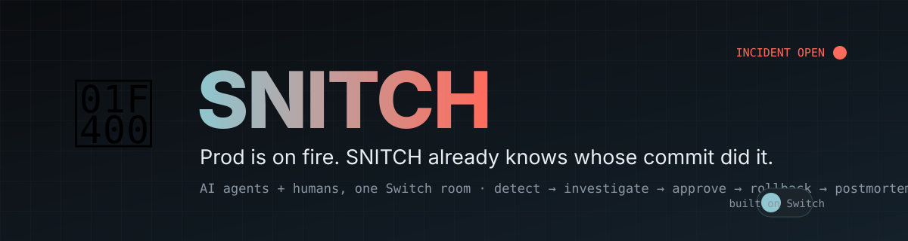
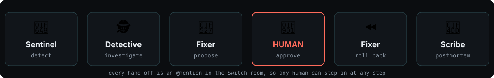
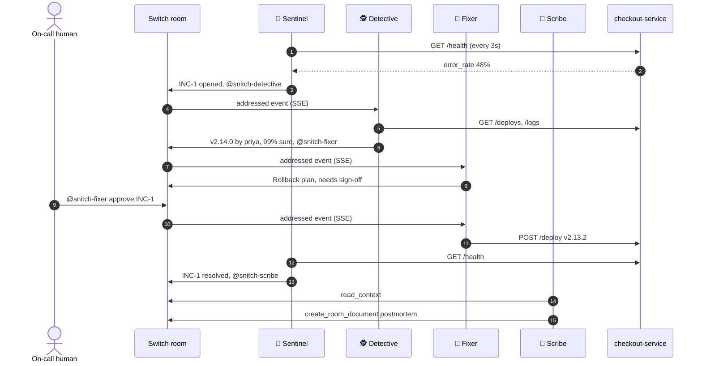

<div align="center">



<br>

[](https://github.com/sandbox-quantum/switch)
[](https://wemakedevs.org/hackathons/switch)
[](#-tests)
[](pyproject.toml)
[](LICENSE)

**[▶ Watch it happen](#-watch-an-incident)** · **[⚡ 60-second demo](#-run-it-in-60-seconds)** · **[🔌 Why Switch](#-why-switch-is-central)** · **[🛠 Use on your service](#-guard-your-own-service)**

</div>

---

## 💥 The problem

It's 3 a.m. Checkout is returning 500s. Six people are in the incident channel asking *"what changed?"* while one person scrolls through deploy logs.

Chat apps are where incidents get handled, but the agents that could actually help live in someone's terminal and can't see the room.

## 🐀 The fix

**SNITCH puts four AI agents in your team's Slack, Discord, Teams, Mattermost or Telegram channel, next to your on-call humans.**

They notice the outage, name the deploy that caused it, propose a rollback, **wait for a human to approve it**, carry it out, confirm recovery and write the postmortem. Every step happens in the channel where everyone can see it and step in.

<div align="center">

</div>

---

## 🎬 Watch an incident

<div align="center">

</div>

<details>
<summary><b>📜 Read the same incident as plain text</b></summary>

```
🚨 snitch-sentinel   INC-1 opened · checkout-service degraded · error rate 48% on v2.14.0
                     @snitch-detective INC-1: find out who did this.
🐀 snitch-detective  SNITCHING INC-1: it was v2.14.0 (c0ffee7 by @priya, "Multi-currency checkout")
                     • 38 errors, first at 09:42:03: POST /checkout 500 KeyError
                     • first error 2s after v2.14.0 went out · 38/38 errors on v2.14.0
                     • confidence 99%
                     @snitch-fixer INC-1 bad=v2.14.0: prepare a rollback.
🔧 snitch-fixer      Rollback plan for INC-1: v2.14.0 → v2.13.2 (9f02d1a)
                     blast radius: one service, stateless · verify: error rate < 25% for 30s
                     Needs human sign-off. Reply "@snitch-fixer approve INC-1" or "reject".
👩 priya             @snitch-fixer approve INC-1
⏪ snitch-fixer      Approved by priya. Rolling checkout-service back to v2.13.2…
🟢 snitch-fixer      v2.13.2 is live and healthy: error rate 0% over 12 requests.
✅ snitch-sentinel   INC-1 resolved · time to recover 1.4 min
                     @snitch-scribe INC-1 is closed. Write the postmortem.
📝 snitch-scribe     Postmortem saved as room document `postmortem-inc-1`.
```

</details>

---

## 🧭 Contents

| | | |
|---|---|---|
| [🔌 Why Switch is central](#-why-switch-is-central) | [🤖 Meet the agents](#-meet-the-agents) | [⚡ 60-second demo](#-run-it-in-60-seconds) |
| [🌐 Run it on real Switch](#-run-it-on-real-switch) | [🛠 Guard your own service](#-guard-your-own-service) | [🛡 Safety model](#-safety-model) |
| [🧪 Tests](#-tests) | [🏗 Architecture](#-architecture) | [🗺 What's next](#-whats-next) |

---

## 🔌 Why Switch is central

> **Take Switch away and SNITCH stops working.** There are four separate agents, and **the Switch room is the only way they talk to each other.** No agent calls another one. They hand work over by `@`-mentioning each other in the room.

| Switch feature | How SNITCH uses it |
|---|---|
| 🔁 **Agent protocol** (SSE down, HTTP up) | [`switch_client.py`](snitch/switch_client.py) implements it from scratch: a connection id reused across reconnects, `Last-Event-ID` resume, a 2-second heartbeat that reopens on 404/409, `gap` frames attached to the next event, `evicted` takeover handling and the `addressed` filter |
| 🏠 **Rooms as shared state** | The room *is* the incident log. The Scribe calls `read_context` and writes the postmortem from what people actually said |
| 📣 **Addressing** | Agents wake only when `@`-mentioned. Hand-offs are mentions, so a human can take over any step (`@snitch-detective INC-1` re-runs the investigation) |
| 📄 **Room documents** | The postmortem is saved with `create_room_document`, so every future agent and human in the room can load it |
| 💬 **Bridges** | The same code works in Slack, Discord, Teams, Mattermost and Telegram |
| 📋 **Room templates** | [`snitch-warroom.template.yaml`](snitch/templates/snitch-warroom.template.yaml) provisions the room, all four agents, their instructions and a kickoff message |
| 🧑‍⚖️ **Human in the loop** | The only destructive action (a deploy) runs only after a human in the channel approves it. You can limit who may approve |

<details>
<summary><b>🔬 Exactly which protocol details are implemented</b></summary>

<br>

| Protocol rule | Where |
|---|---|
| Generate the connection id once, reuse it on reconnect | `SwitchAgent.__post_init__`, persisted in `.snitch/<agent>.conn.json` |
| Resume with `Last-Event-ID`, cursors only move forward | `_consume`, `_on_frame` |
| Beat every 2s; **404 and 409 mean reopen, not back off** | `_heartbeat` raises `Reopen` |
| `connection_state` is the first frame; read the heartbeat interval from it | `_on_frame` |
| A `gap` is not a wake; attach it to the next event | `_pending_gap` |
| `evicted` means another stream took over; reopen | `_on_frame` |
| Operations are posted unwrapped with `X-Switch-Connection-Id` | `SwitchAgent.op` |
| Reconnect with backoff, and a bad event never kills the agent | `run`, `_on_frame` |
| Register once with the registration token; the API key is shown once | `register_agent`, `snitch register` |

</details>

---

## 🤖 Meet the agents

<table>
<tr>
<td width="25%" valign="top">

### 🚨 Sentinel
**Detects.**

Polls service health and takes Alertmanager/Grafana webhooks on `:9100/alert`. Opens `INC-n`, ignores duplicate alerts and declares recovery.

*Try:* `@snitch-sentinel status`

</td>
<td width="25%" valign="top">

### 🕵️ Detective
**Investigates.**

Matches the error spike to the deploy ledger. Names the version, SHA and author, with evidence and a confidence score. With an LLM key, also reads the stack trace for a likely root cause.

*Try:* `@snitch-detective INC-1`

</td>
<td width="25%" valign="top">

### 🔧 Fixer
**Fixes, with permission.**

Picks the last good release and posts a plan, then **waits**. On `approve` from an allowed human it deploys and checks recovery. If the service doesn't recover, it hands the incident back to the humans.

*Try:* `@snitch-fixer approve INC-1`

</td>
<td width="25%" valign="top">

### 📝 Scribe
**Remembers.**

Reads the room history and writes a blameless postmortem as a room document: summary, timeline, decisions and action items.

*Try:* `@snitch-scribe INC-1`

</td>
</tr>
</table>

<details>
<summary><b>💬 Everything you can say to the agents</b></summary>

<br>

| You type | What happens |
|---|---|
| `@snitch-sentinel status` | Reports health, version, error rate and the open incident |
| `@snitch-sentinel page` | Opens an incident by hand |
| `@snitch-detective INC-1` | Re-runs the investigation |
| `@snitch-fixer INC-1 bad=v2.14.0` | Prepares a rollback plan for a version you choose |
| `@snitch-fixer approve INC-1` | Executes the rollback (approver allowlist enforced) |
| `@snitch-fixer reject INC-1` | Stands the fixer down |
| `@snitch-scribe INC-1` | Writes or rewrites the postmortem |

</details>

---

## ⚡ Run it in 60 seconds

No Switch server needed for the demo. It runs a local stand-in that speaks the same protocol, plus a web chat and a real service to break.

<details open>
<summary><b>🪟 Windows (PowerShell)</b></summary>

```powershell
git clone https://github.com/shubhamjh15/hacktheSwitch-.git
cd hacktheSwitch-
python -m venv .venv
.venv\Scripts\activate
pip install -e ".[llm]"
snitch demo --port 8077
```

</details>

<details>
<summary><b>🍎🐧 macOS / Linux</b></summary>

```bash
git clone https://github.com/shubhamjh15/hacktheSwitch-.git
cd hacktheSwitch-
python -m venv .venv && source .venv/bin/activate
pip install -e ".[llm]"
snitch demo --port 8077
```

</details>

<details>
<summary><b>🐳 Docker</b></summary>

```bash
docker build -t snitch .
docker run --rm -e SNITCH_BIND=0.0.0.0 -p 8077:8077 -p 9000:9000 snitch demo --port 8077
```

</details>

Then:

1. Open **http://localhost:8077**.
2. Click **💥 Ship v2.14.0**. That deploys a release with a real bug.
3. Watch the agents open the incident and name the commit.
4. Click **✅ approve rollback**.
5. Open the postmortem under **Room documents**.

The demo service is real. v2.14.0 ships a genuine `KeyError` on GBP and JPY checkouts, and rolling back genuinely fixes it.

---

## 🌐 Run it on real Switch

<details>
<summary><b>Step-by-step</b></summary>

<br>

1. **Install** [Switch Console](https://github.com/sandbox-quantum/switch/releases/latest) and connect your chat app ([guide](https://docs.switchagents.ai/switch-rooms/deploy/messaging-apps/index)).
2. **Configure.** `cp .env.example .env`, then set `SWITCH_URL` (the agent bridge) and `SWITCH_REGISTRATION_TOKEN`.
3. **Create the four agents** in Console: *Your Agents → +*, named `snitch-sentinel`, `snitch-detective`, `snitch-fixer` and `snitch-scribe` (provider: Claude Code). They are ordinary Console-run agents. The room template gives them their roles and tools.
   *(Self-hosted Switch with a registration token can instead run `snitch register` and `snitch run` for the always-on watcher.)*
4. **Create the war room** in Console: *Templates → Import →* [`snitch-warroom.template.yaml`](snitch/templates/snitch-warroom.template.yaml), then pick your bridge.
5. **Start** the guarded service: `snitch victim` (or point `SNITCH_SERVICE_URL` at your own).
6. **Break it:** `snitch break`. Then in the room: `@snitch-sentinel status`, and later `@snitch-fixer approve INC-1`.

The agents call these shell tools, so the humans see real output in the room: `snitch status`, `snitch evidence`, `snitch plan <ver>` and `snitch rollback <ver> --approved-by <human>`. The rollback refuses to run without a named human approver.

**With Docker Compose:**
```bash
docker compose run --rm snitch register
docker compose up -d
```

</details>

<details>
<summary><b>⚙️ All configuration</b></summary>

<br>

| Variable | Default | Meaning |
|---|---|---|
| `SWITCH_URL` | `http://localhost:8000` | Switch **agent bridge** (not the Gateway) |
| `SWITCH_REGISTRATION_TOKEN` | | Used once by `snitch register` |
| `SNITCH_ROOM_ID` | auto | Pin the war room; otherwise the room whose name contains `snitch` |
| `SNITCH_SERVICE_URL` | `http://localhost:9000` | The service SNITCH guards |
| `SNITCH_ERROR_THRESHOLD` | `0.25` | Error rate that opens an incident |
| `SNITCH_POLL_SECONDS` | `3` | Health probe interval |
| `SNITCH_APPROVERS` | empty | Comma-separated names allowed to approve (empty means anyone in the room) |
| `ANTHROPIC_API_KEY` | empty | Optional: an LLM writes verdicts and postmortems |
| `SNITCH_MODEL` | `claude-sonnet-5-5` | Model used when a key is set |

</details>

---

## 🛠 Guard your own service

SNITCH needs four HTTP endpoints. Expose them directly, or put a thin adapter in front of your deploy tool.

| Endpoint | Returns |
|---|---|
| `GET /health` | `{service, version, error_rate, requests_30s, status}` |
| `GET /deploys` | `[{version, sha, author, message, at, actor}]` |
| `GET /logs?level=ERROR` | `[{at, level, version, message, trace}]` |
| `POST /deploy {version, actor}` | the new deploy entry |

Already have Prometheus or Grafana? Point an alert webhook at `http://<host>:9100/alert`. Alertmanager's payload is understood and repeat alerts are deduplicated.

---

## 🛡 Safety model

| Rule | Why |
|---|---|
| **Nothing destructive without a human.** The Fixer posts a plan and waits | Rolling back prod is a decision, not a reflex |
| **Approver allowlist.** `SNITCH_APPROVERS=priya,sam` | In the end-to-end test, `mallory` is refused |
| **One incident at a time, deduplicated** | A noisy alert can't open fifty incidents |
| **Failure hands back to humans.** If the rollback doesn't recover the service, the Fixer escalates | The agents never claim a win they didn't get |
| **No agent loops.** Agents ignore each other's chatter once an incident is closed, and quoted room text can't re-address anyone | Found and fixed during testing |
| **LLM is optional.** Without a key, deterministic templates are used | The workflow never depends on a model being up |
| **Blameless by design.** The Detective names the *change*, not a culprit | Postmortems are for learning |

---

## 🧪 Tests

```bash
pip install -e ".[dev]"
pytest
```

| Test | Proves |
|---|---|
| `test_investigate.py` | The deploy that caused an error spike is named correctly, with sensible confidence |
| `test_sse.py` | The SSE parser handles ids, multi-line data and keepalives |
| **`test_e2e.py`** | A **full incident over real HTTP and SSE**: break prod, incident opens, bad release named, unauthorised approval refused, authorised approval executes, service recovers, postmortem saved, and no agent re-triggers afterwards |

---

## 🏗 Architecture



```
snitch/
├── switch_client.py   Switch agent-protocol client (SSE, heartbeat, ops)
├── agents.py          the four agents
├── investigate.py     deploy/error correlation (pure, unit-tested)
├── runtime.py         wiring + alert webhook
├── victim.py          demo checkout-service with a real bug
├── mock_switch.py     local protocol stand-in + web chat (demo and tests only)
├── brain.py           optional LLM layer with template fallback
├── static/room.html   war-room web UI
└── templates/         Switch room template
```

---

## 🗺 What's next

- [ ] GitHub adapter: open a revert PR instead of calling a deploy API
- [ ] Kubernetes adapter: `kubectl rollout undo` behind the same approval gate
- [ ] Multi-service rooms, with one Detective per service
- [ ] Pager integration (PagerDuty / Opsgenie) for the human escalation step

---

<div align="center">

Built for the **[Flip the Switch Hackathon](https://wemakedevs.org/hackathons/switch)** · powered by **[Switch AI](https://github.com/sandbox-quantum/switch)**

<sub>MIT licensed · prod is on fire, but at least you know whose commit it was 🐀</sub>

</div>
