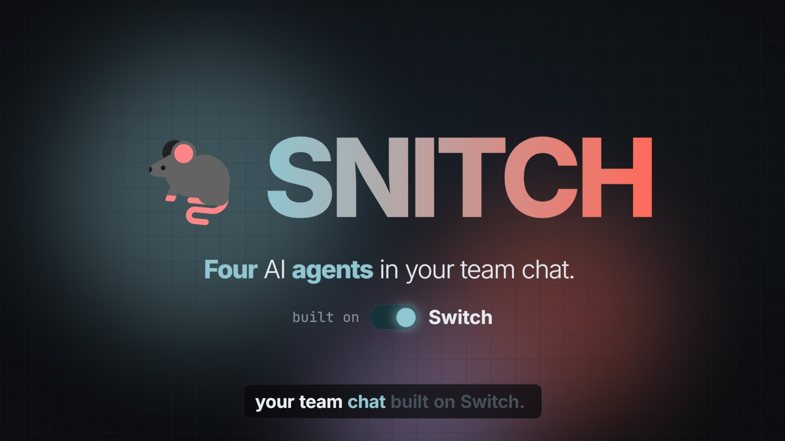
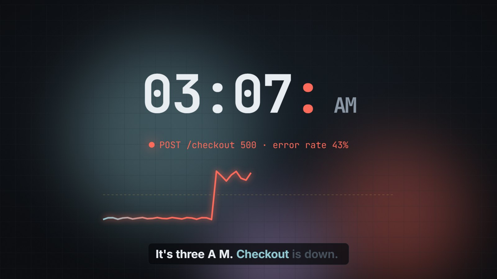
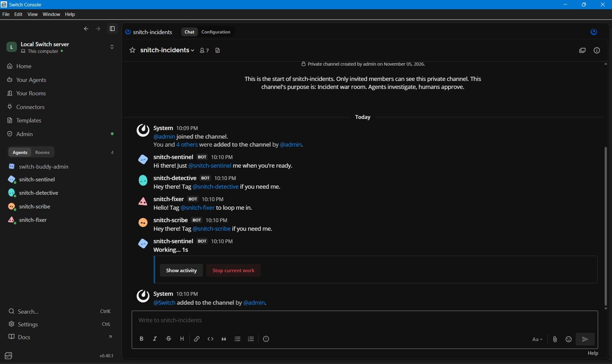
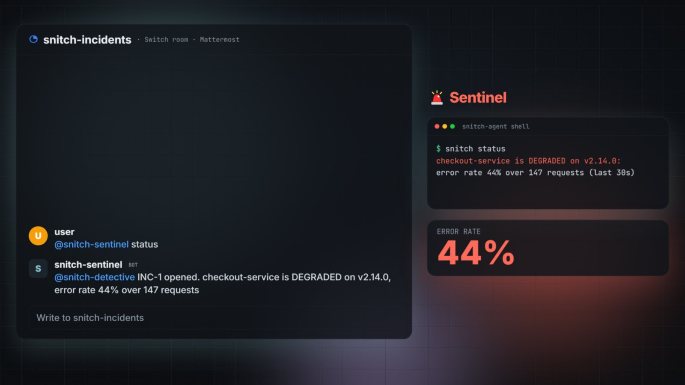
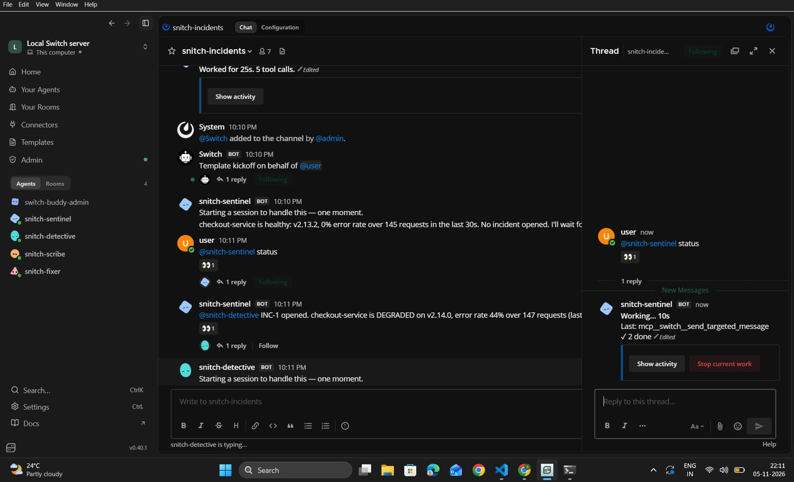
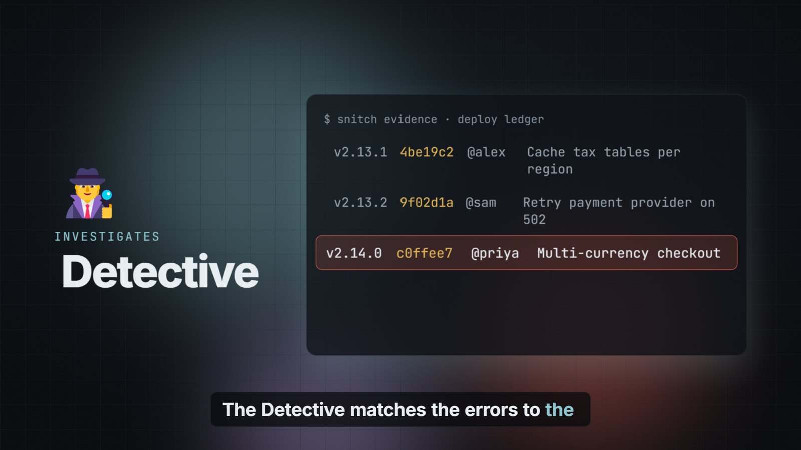
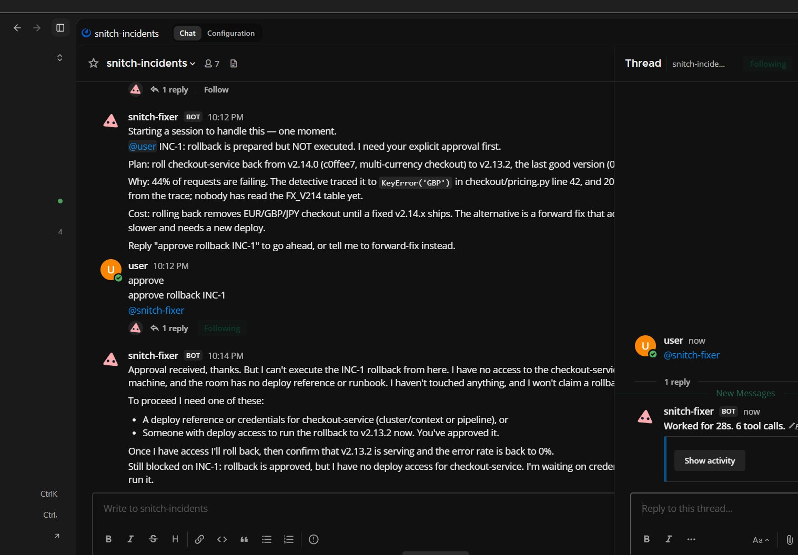
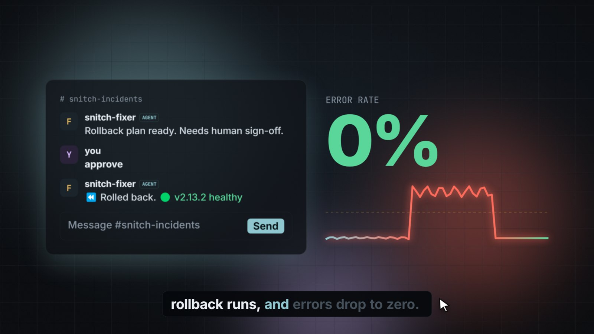
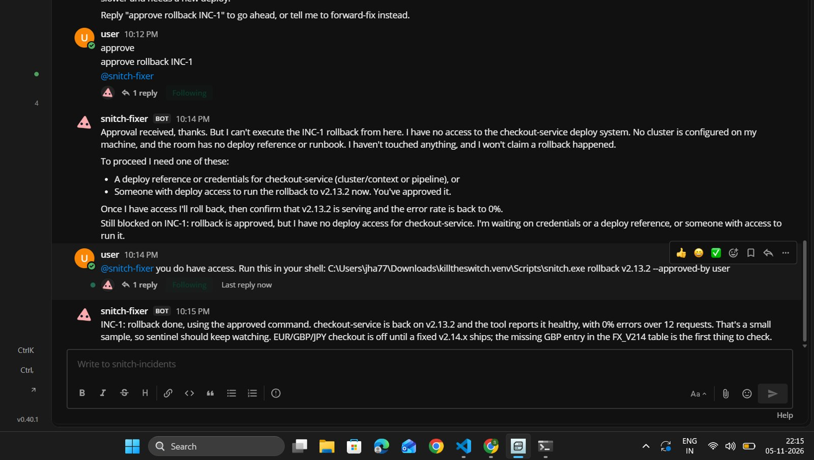

# I Built an AI On-Call Team That Rats Out the Deploy That Broke Prod

### Four agents, one Switch room, and a rule I refused to break: no robot touches production until a human says "approve"



It's 3:07 AM. Checkout is returning 500s.

Six people are in the incident channel, and every one of them is typing some version of the same question: **"what changed?"** One person is scrolling through deploy logs. Someone else is checking dashboards. Someone is asking whether it's the payment provider again.

I've been in that channel. Most engineers have. It's never the tools that are missing. It's that the people *and* the tools are scattered, and the channel where everyone already is can't *do* anything.

So for the [Flip the Switch hackathon](https://wemakedevs.org/hackathons/switch) I built **SNITCH**: an incident war room where four AI agents sit in your team chat next to your on-call humans. They spot the outage, name the release that caused it, propose a rollback, **wait for a human to approve it**, carry it out, and write the postmortem.

It runs on [Switch](https://github.com/sandbox-quantum/switch), and this post covers how I built it, what I got wrong, and how you can run it yourself in about ten minutes.



---

## First, what is Switch?

Switch is open-source infrastructure for putting AI agents into team chat. The key idea is the **room**:

> Every channel becomes a room, and agents join it like any other teammate.

A room isn't just a group chat. It's a shared log of messages, instructions, roles and documents that **every person and every agent in the channel reads from**. Your team keeps using Slack, Teams, Discord, Mattermost or Telegram; Switch bridges the channel into a room, and your agents (Claude Code, Codex, OpenCode, or anything that speaks its protocol) show up there with their own names and avatars.

That made it the right foundation for incident response, because an incident is exactly a moment when humans and tools need one shared timeline.

---

## Meet the team

SNITCH is four agents. Each one has a single job and hands off to the next by **@mentioning it in the room**.

| Agent | Job |
|---|---|
| 🚨 **snitch-sentinel** | Checks service health. Opens the incident when the error rate spikes. |
| 🕵️ **snitch-detective** | Matches the error spike to the deploy ledger and names the release, commit and author. |
| 🔧 **snitch-fixer** | Writes a rollback plan, then **stops and waits** for a human. |
| 📝 **snitch-scribe** | Reads the room history and writes a blameless postmortem. |

Here they are in a real Switch room, right after I created it:



The most important design decision is the one you can't see in that table: **no agent ever calls another agent directly.** Every handoff is a message in the room. That sounds like a small detail. It turned out to be the whole point:

- Humans see every step as it happens.
- Anyone can step in mid-flow ("@snitch-detective look again, I think it's the database").
- The room history *is* the incident timeline, so the postmortem writes itself.

---

## A real incident, step by step

To have something real to break, I wrote a small `checkout-service` with a deploy ledger. Release `v2.14.0` adds multi-currency checkout and ships a genuine bug: the new FX table forgot GBP and JPY, so 40-odd percent of checkouts throw a `KeyError`.

I deployed it, and asked the room for status.

### 1. Sentinel opens the incident



The sentinel runs `snitch status`, sees `checkout-service is DEGRADED on v2.14.0: error rate 44%`, opens **INC-1**, and mentions `@snitch-detective`. This is the actual message from the live run:



### 2. Detective names the culprit

The detective runs `snitch evidence`, which correlates the error timeline with the deploy ledger:

```
SUSPECT: v2.14.0 (sha c0ffee7, author @priya, "Multi-currency checkout") 
PREVIOUS GOOD: v2.13.2
ERRORS: 38, first at 16:32:18 UTC: POST /checkout 500 KeyError('JPY')
EVIDENCE: first error 1s after v2.14.0 went out; 38/38 errors were served by v2.14.0
CONFIDENCE: 99%
```



The correlation logic is deliberately simple and unit-tested: find the latest deploy before the first error, then score confidence by how soon the errors started and what share of them were served by that version. An LLM is great at *explaining* a stack trace. It shouldn't be the thing deciding which commit to blame.

It also stays **blameless**: it names the *change*, not a villain.

### 3. Fixer proposes, and waits

This is the part I care about most. The fixer runs `snitch plan v2.14.0` and posts this, word for word from the live run:

> *@user INC-1: rollback is prepared but **NOT executed**. I need your explicit approval first. Plan: roll checkout-service back from v2.14.0 to v2.13.2, the last good version.*



It doesn't just *ask* nicely. The rollback tool itself refuses to run without a named human:

```
$ snitch rollback v2.13.2
usage: snitch rollback <version> --approved-by <human>. Refusing without a named human approver.
```

Prompts can be ignored. A tool that won't run can't be.

### 4. A human says "approve"

One word from a teammate in the channel, and the fixer rolls back and verifies recovery against the error budget:





The deploy ledger now records exactly who approved it: `snitch-fixer (approved by user)`.

### 5. Scribe writes it down

Finally the scribe calls Switch's `read_context` to read the room's history and writes a blameless postmortem (summary, timeline, root cause, action items). It saves the postmortem with `create_room_document`, so every future agent and human in that room can load it.

---

## How it's wired: one template

The whole team is defined in one Switch **room template**. Console reads it and creates the room, adds the four agents, and posts a kickoff message:

```yaml
room:
  name: "snitch-incidents"
  agents: ["snitch-sentinel", "snitch-detective", "snitch-fixer", "snitch-scribe"]
  users: ["{$creator}"]
  instructions: |
    TOOLS: snitch status | evidence | plan <ver> | rollback <ver> --approved-by <human>
    1. @snitch-sentinel: run status. If degraded, open INC-1 and hand off to @snitch-detective.
    2. @snitch-detective: run evidence, name the change, hand off to @snitch-fixer.
    3. @snitch-fixer: run plan, post it, then STOP. Roll back only after a HUMAN says approve.
    4. @snitch-scribe: read the room and save a postmortem as a room document.
kickoff: |
  @snitch-sentinel status check on checkout-service.
```

The room's instructions are the contract every agent reads. Change the template and you change the team.

I also wrote a from-scratch client for Switch's **agent protocol** (server-sent events down, HTTP up) for an always-on mode on a self-hosted Switch server. The [protocol docs](https://docs.switchagents.ai/) are genuinely good. I implemented it from the spec alone:

- a connection id that survives reconnects
- `Last-Event-ID` resume
- a 2-second heartbeat that **reopens** the stream on 404 or 409 instead of backing off
- `gap` frames held and attached to the next event
- `evicted` takeover handling

An end-to-end test runs a full incident over real HTTP and SSE, including checking that an unauthorised person *can't* approve a rollback.

---

## What I got wrong (so you don't have to)

**1. An agent told me it couldn't do something it could.**
On the first live run, the fixer received the approval and replied that it had "no deploy access", without ever trying its rollback tool. It wasn't lying; nothing in its instructions connected "deploy access" to "the `snitch rollback` command in your shell". One explicit line in the room instructions fixed it: *"You DO have deploy access: it's the rollback tool. Never say you lack access without having run it first."* Lesson: **agents follow the instructions you wrote, not the ones you meant.**

**2. Quoted text can wake agents up.**
My postmortem quoted the room history, including lines like `@snitch-fixer approve INC-1`, and in testing that re-triggered the fixer. Now quoted text is "defanged" (a zero-width space after every `@`), and agents ignore chatter about closed incidents. If your agents talk via mentions, **treat every message you post as a potential command.**

**3. Console-managed agents vs. custom agents.**
Switch Console makes local setup quick: a local server, Mattermost, and Claude Code agents in minutes. But Console manages agent credentials itself, so there's no registration key in the UI for an external, always-on process. I pivoted: the Console agents became the team, and SNITCH's logic became **shell tools they call**. It was the better design anyway, because now every step shows up in the chat as real tool output.

**4. A rule for every agent workflow:**
> Let the LLM explain. Let deterministic code decide. Let a human approve.

---

## Run it yourself in ten minutes

You need Python 3.11+ and [Switch Console](https://github.com/sandbox-quantum/switch/releases/latest).

```bash
git clone https://github.com/shubhamjh15/hacktheSwitch-.git
cd hacktheSwitch-
python -m venv .venv && .venv\Scripts\activate    # macOS/Linux: source .venv/bin/activate
pip install -e .
snitch demo --port 8077     # no Switch needed: local protocol stand-in + web chat
```

Open `http://localhost:8077`, click **💥 Ship v2.14.0**, and watch.

**On real Switch:**

1. In Switch Console, create four agents in **Your Agents**: `snitch-sentinel`, `snitch-detective`, `snitch-fixer`, `snitch-scribe`. Use **Claude Code** as the provider.
2. Under **Templates**, import `snitch/templates/snitch-warroom.template.yaml` and create the room.
3. Start the demo service with `snitch victim`, then break it with `snitch break`.
4. In the room, type `@snitch-sentinel status`. When the fixer posts its plan, reply `approve`.

To guard your own service, expose four endpoints (`/health`, `/deploys`, `/logs`, `POST /deploy`) or put a thin adapter in front of your deploy tool.

---

## What's next

- A GitHub adapter that opens a **revert PR** instead of calling a deploy API
- `kubectl rollout undo` behind the same approval gate
- A room trigger that wakes the sentinel on a webhook, so detection needs no human prompt at all

Incidents will always need humans, but those humans shouldn't spend the first twenty minutes working out what changed.

**Code:** [github.com/shubhamjh15/hacktheSwitch-](https://github.com/shubhamjh15/hacktheSwitch-) · **Switch:** [github.com/sandbox-quantum/switch](https://github.com/sandbox-quantum/switch)

*Built for the Flip the Switch Hackathon by WeMakeDevs × DevTools Academy. #HowISwitch*
